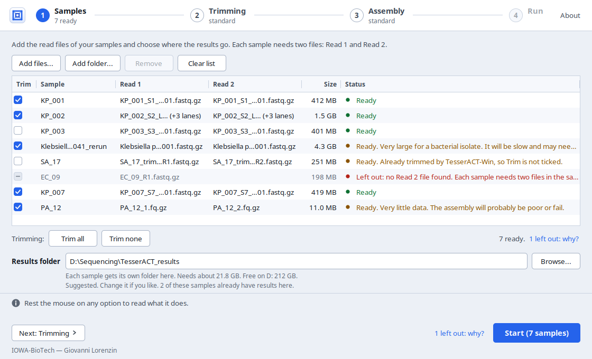
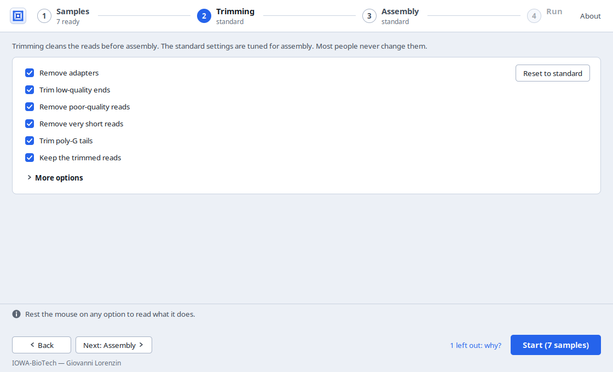
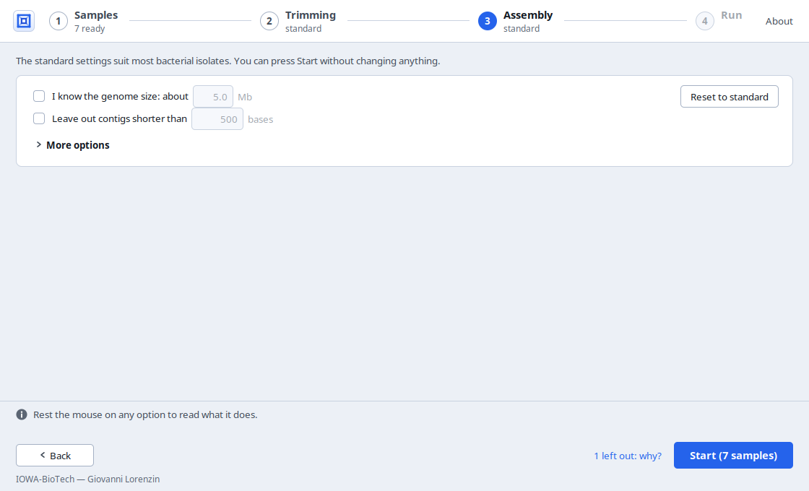
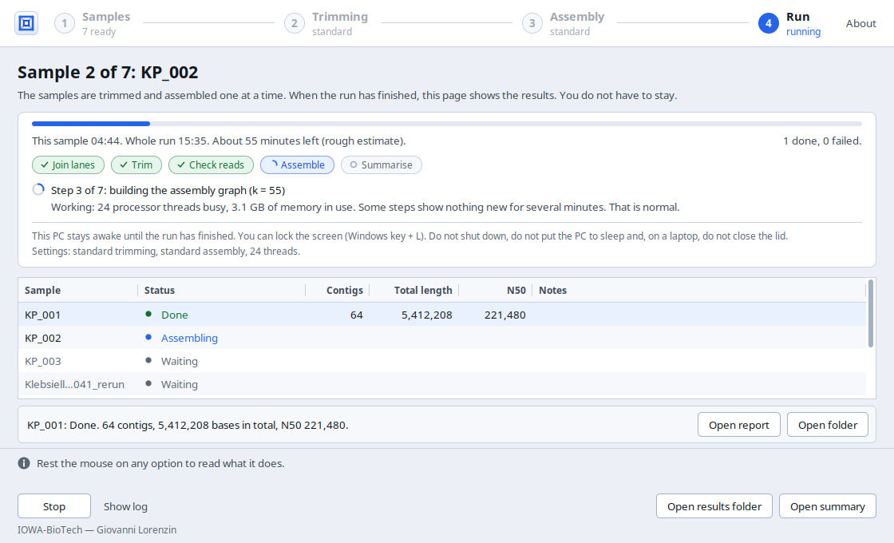
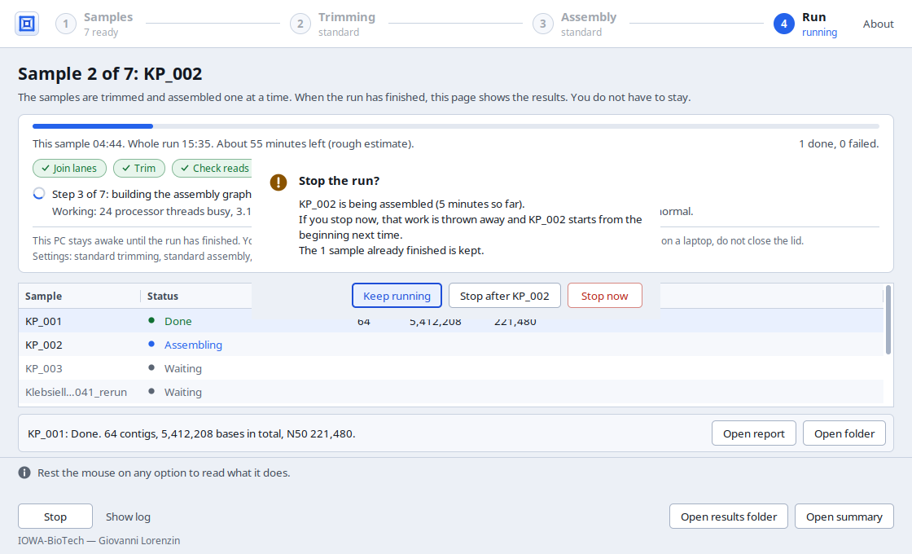
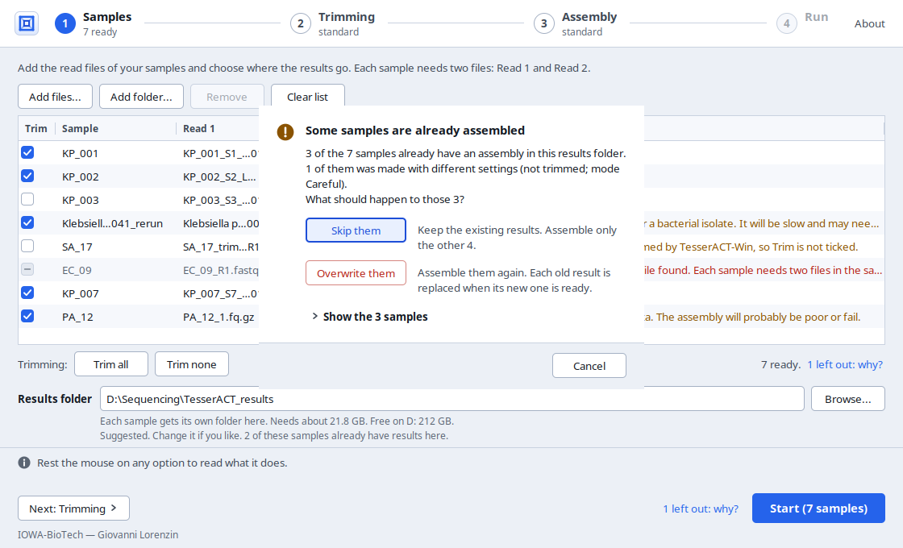
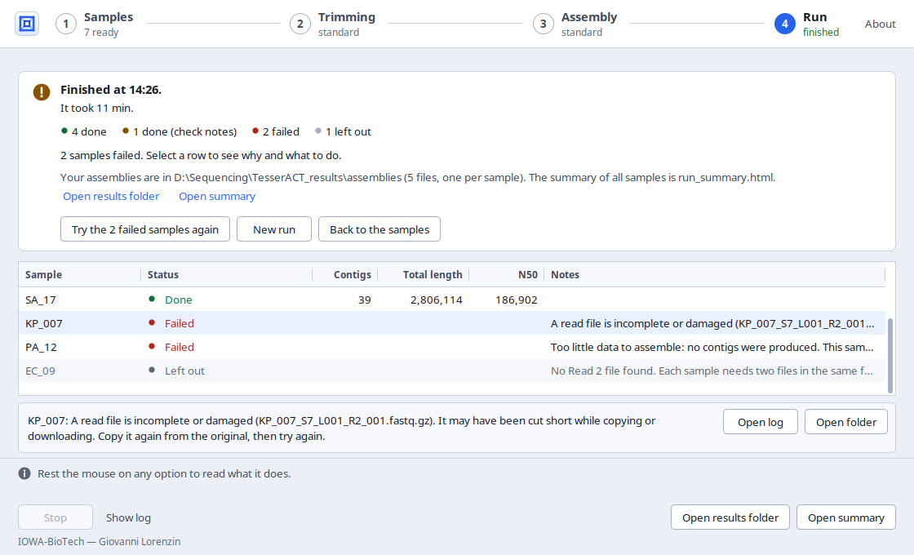

# TesserACT-Win

**Trim and assemble bacterial genomes on Windows.** Add your read files, press Start, get
assemblies.

No installation, no command line, no Linux, no internet connection after the download.

*IOWA-BioTech — Giovanni Lorenzin*

TesserACT-Win is a window around two programs, built here as native Windows programs:

- [TesserACT](https://github.com/iowa69/TesserACT), a de novo assembler for bacterial
  isolates sequenced with paired-end Illumina reads;
- scepter, a read trimmer.

It does on Windows what `scepter` followed by `tesseract` does on Ubuntu, for as many
samples as you give it, one after another.

---

## Download

Go to the [latest release](https://github.com/iowa69/TesserACT-Win/releases/latest) and
take the file ending `-win64-portable.zip`.

1. **Extract the whole zip** (right-click, *Extract All...*). Do not start the program
   from inside the zip.
2. Open the `TesserACT-Win` folder and double-click **`TesserACT-Win.exe`**.

Nothing is installed, nothing is written to the registry and no administrator password
is needed. The folder can live anywhere, including a USB stick.

> **Windows will say "Windows protected your PC".**
> Click **More info**, then **Run anyway**.
>
> This is Windows SmartScreen. It is not a virus warning. TesserACT-Win is **not
> code-signed**, so SmartScreen has never seen the file before and says so. We will never
> ask you to switch SmartScreen or your antivirus off.
>
> Every release publishes `SHA256SUMS.txt`, so you can confirm that the file you
> downloaded is exactly the file that was built. In PowerShell:
>
> ```powershell
> Get-FileHash .\TesserACT-Win-<version>-win64-portable.zip -Algorithm SHA256
> ```

**Requirements:** Windows 10 or 11, 64-bit. About 4 GB of free memory for an assembly.

---

## Four steps

*The screenshots use made-up sample names.*

### 1. Samples



Add files, add a folder, or drop them on the window. Each sample needs two files: Read 1
and Read 2. The program pairs them by name (`_R1`/`_R2`, `_1`/`_2`, and Illumina's
`_S1_L001_R1_001`), joins the lanes of a sample that was sequenced over several, and
tells you at once about any file it cannot use and why.

Choose the results folder. Every sample gets its own folder there, and the page shows
how much space the run needs against what is free.

New here? **Try the example** runs a small made-up isolate through the whole program in
about a minute.

### 2. Trimming (optional)



The standard settings are already ticked: remove adapters, trim low-quality ends, remove
poor and very short reads, trim poly-G tails. They are scepter's settings for assembly.
Each option explains itself when you rest the mouse on it. Untick **Trim** on a sample to
assemble its reads as they are.

### 3. Assembly (optional)



The standard settings suit most bacterial isolates. Say the genome size if you know it,
or leave out very short contigs. Assembly mode, scaffolding, polishing and the number of
processor threads are under **More options**.

### 4. Start

Press **Start** on any of the first three pages: it starts at once. Samples are trimmed
and assembled one at a time, each using every processor thread. You can lock the screen
and leave it.



**Stop** asks first, and tells you what would be lost:



If a sample already has an assembly in the results folder, the program asks whether to
**skip** it or **overwrite** it. An old result is replaced only when its new one is ready:



When the run has finished, the page says what happened to every sample, with the reason
and the next step for any that failed:



After a stop, a crash or a restart of Windows, **Continue** picks the run up where it
was. Finished samples are never done twice.

---

## What you get

In the results folder:

| | |
| :-- | :-- |
| `run_summary.html` | **Start here.** Every sample, what happened, and links. Needs no internet. |
| `run_summary.tsv` | The same as a table for other software. |
| `assemblies\` | One FASTA file per sample, named after the sample. |
| `<sample>\assembly\` | Everything TesserACT writes: `contigs.fasta`, `SUMMARY.txt`, `report.html`, `assembly_graph.gfa` (for Bandage), `assembly_stats.tsv` and more. |
| `<sample>\trimming\` | The trimmed reads and the trimming report. |

The contents of `<sample>\assembly\` are what `tesseract -o` writes on Ubuntu.
[TesserACT's README](https://github.com/iowa69/TesserACT#the-output) explains each file.

---

## The same assembly as on Linux

TesserACT-Win does not re-implement the assembler. It compiles TesserACT's own source,
unmodified, for Windows, and adds what Windows needs in separate files.

Every build of this program is made in public by
[GitHub Actions](https://github.com/iowa69/TesserACT-Win/actions), and a release is only
published if, in that same run:

- TesserACT's own test suite and scepter's own test suites pass on the Windows build;
- for a fixed set of reads, the Windows engines write **byte-identical** contigs, graphs
  and trimmed reads to the Linux engines;
- the checks and the summary this program writes (`preflight.txt`, `SUMMARY.txt`,
  `assembly_stats.tsv`) agree with the Ubuntu `tesseract` command on a library of good
  and deliberately broken read sets;
- the finished program, started from a folder with spaces and accents in its name,
  trims and assembles the example from end to end.

## What it does not do

- It runs TesserACT **without organism models** (the "vanilla" assembly). Models are a
  feature of TesserACT on Linux and macOS.
- It does not map reads back to the assembly (that needs `bwa` or `minimap2`);
  `SUMMARY.txt` says so. TesserACT's k-mer self-check, which is included, covers
  completeness.
- Paired-end Illumina reads only: no single-end, interleaved or long reads.
- It is research software, not a diagnostic device.

---

## For developers

```
engines/tesseract/upstream/   TesserACT, pinned and never edited
engines/scepter/upstream/     scepter, pinned and never edited
engines/win/                  what Windows needs: compatibility layers and build recipes
tesseract_win/                the program (Python, standard library only)
tests/                        tests, including outputs captured from the real tesseract script
packaging/                    PyInstaller recipe and the files that ship in the zip
```

Build the engines: `python engines/build.py --target linux` (or `windows`, with GCC from
MSYS2 UCRT64). Run the tests: `python -m pytest`. Run from source: `python -m tesseract_win`.

**A new TesserACT release** is brought in with one command; see
[`engines/UPDATING.md`](engines/UPDATING.md). The build fails, and shows where, if the
new release changed something the Windows version depends on.

## Licence and citation

MIT licence, see [`LICENSE`](LICENSE). Third-party notices: [`NOTICE`](NOTICE).

If you use assemblies made with this program, please cite TesserACT as described in
[its repository](https://github.com/iowa69/TesserACT).
